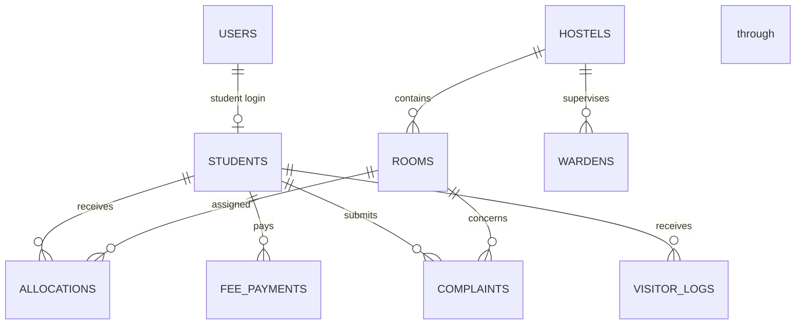

# Hostel Management System: Technical Report

**Course:** AI203, Database Management Systems  
**Institute:** SVNIT Surat, B.Tech II  
**Project status:** Local demo implementation

## Team Members

| Member name | Roll number | Project role | Contribution |
|---|---|---|---|
| [Member 1] | [Roll number] | [Coordinator / Database] | [To be completed by team] |
| [Member 2] | [Roll number] | [Backend] | [To be completed by team] |
| [Member 3] | [Roll number] | [Frontend / Testing] | [To be completed by team] |
| [Add or remove rows as needed] | | | |

## 1. Executive Summary

College hostel administration coordinates resident records, room capacity, fee records, maintenance complaints, and visitor entries. Maintaining these records separately can create inconsistent room counts, slow searches, and difficulty identifying unpaid fees.

This project provides a small web application backed by a normalized MySQL database. Administrators can manage records and view reports. Students can view their own profile, fee payments, and complaints, and inspect room availability. Room allocation uses a transaction and database trigger so that simultaneous requests cannot allocate a full room through this API and successful allocations update occupancy.

The implementation is intentionally limited to nine tables and a single Express API. It is suitable as a local learning project, not as production hostel software.

## 2. Database Architecture

### 2.1 Entities and ER Diagram

Each student has exactly one login, while an admin login has no student row. A hostel can contain many rooms and can have multiple warden records. Allocation rows retain room assignment history; the application permits one active allocation per student at a time. Students can have multiple fee payments, complaints, and visitor records. Complaints identify both the student who submitted the issue and the room concerned.

### 2.2 Relational Schema

`PK` means primary key, `FK` foreign key, and `UQ` unique. All tables use InnoDB.

- `users(user_id PK, username UQ, password, role, created_at)`
- `hostels(hostel_id PK, name UQ, type, total_rooms)`
- `rooms(room_id PK, hostel_id FK -> hostels, room_number, capacity, current_occupancy, fee_per_sem, status, UQ(hostel_id, room_number))`
- `wardens(warden_id PK, hostel_id FK -> hostels, name, phone, email UQ)`
- `students(student_id PK, user_id FK/UQ -> users, roll_number UQ, name, gender, phone, email UQ, department, year_of_study)`
- `allocations(allocation_id PK, student_id FK -> students, room_id FK -> rooms, allocation_date, status)`
- `fee_payments(payment_id PK, student_id FK -> students, amount_paid, payment_date, payment_mode, receipt_no UQ)`
- `complaints(complaint_id PK, student_id FK -> students, room_id FK -> rooms, title, description, category, status, created_at)`
- `visitor_logs(visitor_id PK, student_id FK -> students, visitor_name, relation, phone, visit_date, in_time, out_time)`

The DDL also uses `NOT NULL`, `DEFAULT`, `ENUM`, and numeric `CHECK` constraints. Examples include positive fee amounts, room occupancy between zero and capacity, study year from one to four, and default statuses/dates.

### 2.3 Data Dictionary

#### `users` - login identity and role

| Column | Type | Key / rule | Meaning |
|---|---|---|---|
| user_id | INT | PK, auto increment | Login identifier |
| username | VARCHAR(50) | NOT NULL, UQ | Login name |
| password | VARCHAR(100) | NOT NULL | Classroom demo password |
| role | ENUM(ADMIN, STUDENT) | NOT NULL, DEFAULT STUDENT | Authorization role |
| created_at | TIMESTAMP | DEFAULT current timestamp | Account creation time |

#### `hostels` - hostel buildings

| Column | Type | Key / rule | Meaning |
|---|---|---|---|
| hostel_id | INT | PK, auto increment | Hostel identifier |
| name | VARCHAR(100) | NOT NULL, UQ | Hostel name |
| type | ENUM(BOYS, GIRLS) | NOT NULL | Hostel category |
| total_rooms | INT | NOT NULL, DEFAULT 10, CHECK > 0 | Declared room count |

#### `rooms` - rooms and bed capacity

| Column | Type | Key / rule | Meaning |
|---|---|---|---|
| room_id | INT | PK, auto increment | Room identifier |
| hostel_id | INT | FK, NOT NULL | Parent hostel |
| room_number | VARCHAR(10) | NOT NULL | Room label within a hostel |
| capacity | INT | NOT NULL, DEFAULT 2, CHECK 1-4 | Number of beds |
| current_occupancy | INT | NOT NULL, DEFAULT 0, CHECK 0 to capacity | Occupied beds, maintained by trigger |
| fee_per_sem | DECIMAL(10,2) | NOT NULL, DEFAULT 25000, CHECK > 0 | Semester room fee |
| status | ENUM(AVAILABLE, FULL, MAINTENANCE) | NOT NULL, DEFAULT AVAILABLE | Operational room state |
| hostel_id + room_number | - | UQ | Room label unique within a hostel |

#### `wardens` - hostel staff contacts

| Column | Type | Key / rule | Meaning |
|---|---|---|---|
| warden_id | INT | PK, auto increment | Warden identifier |
| hostel_id | INT | FK, NOT NULL | Assigned hostel |
| name | VARCHAR(100) | NOT NULL | Warden name |
| phone | VARCHAR(15) | NOT NULL | Contact phone |
| email | VARCHAR(100) | NOT NULL, UQ | Contact email |

#### `students` - student records

| Column | Type | Key / rule | Meaning |
|---|---|---|---|
| student_id | INT | PK, auto increment | Student identifier |
| user_id | INT | FK, NOT NULL, UQ | Student login account |
| roll_number | VARCHAR(20) | NOT NULL, UQ | College roll number |
| name | VARCHAR(100) | NOT NULL | Student name |
| gender | ENUM(MALE, FEMALE) | NOT NULL | Hostel allocation category |
| phone | VARCHAR(15) | NOT NULL | Contact phone |
| email | VARCHAR(100) | NOT NULL, UQ | Student email |
| department | VARCHAR(50) | NOT NULL | Academic department |
| year_of_study | INT | NOT NULL, DEFAULT 2, CHECK 1-4 | Current study year |

#### `allocations` - assignment history

| Column | Type | Key / rule | Meaning |
|---|---|---|---|
| allocation_id | INT | PK, auto increment | Allocation identifier |
| student_id | INT | FK, NOT NULL | Assigned student |
| room_id | INT | FK, NOT NULL | Assigned room |
| allocation_date | DATE | NOT NULL | Assignment date |
| status | ENUM(ACTIVE, VACATED) | NOT NULL, DEFAULT ACTIVE | Current/history state |

#### `fee_payments` - payment transactions

| Column | Type | Key / rule | Meaning |
|---|---|---|---|
| payment_id | INT | PK, auto increment | Payment identifier |
| student_id | INT | FK, NOT NULL | Paying student |
| amount_paid | DECIMAL(10,2) | NOT NULL, CHECK > 0 | Transaction amount |
| payment_date | DATE | NOT NULL | Payment date |
| payment_mode | ENUM(ONLINE, UPI, CASH, CHALLAN) | NOT NULL, DEFAULT ONLINE | Payment channel |
| receipt_no | VARCHAR(50) | NOT NULL, UQ | Receipt identifier |

#### `complaints` - student maintenance issues

| Column | Type | Key / rule | Meaning |
|---|---|---|---|
| complaint_id | INT | PK, auto increment | Complaint identifier |
| student_id | INT | FK, NOT NULL | Student who submitted it |
| room_id | INT | FK, NOT NULL | Room concerned |
| title | VARCHAR(150) | NOT NULL | Short issue summary |
| description | TEXT | NOT NULL | Issue details |
| category | ENUM(ELECTRICAL, PLUMBING, CARPENTRY, CLEANLINESS, WIFI) | NOT NULL | Issue type |
| status | ENUM(PENDING, RESOLVED) | NOT NULL, DEFAULT PENDING | Resolution state |
| created_at | TIMESTAMP | DEFAULT current timestamp | Submission time |

#### `visitor_logs` - gate visitor register

| Column | Type | Key / rule | Meaning |
|---|---|---|---|
| visitor_id | INT | PK, auto increment | Visitor entry identifier |
| student_id | INT | FK, NOT NULL | Student receiving visitor |
| visitor_name | VARCHAR(100) | NOT NULL | Visitor name |
| relation | VARCHAR(50) | NOT NULL | Relation to resident |
| phone | VARCHAR(15) | NOT NULL | Visitor contact |
| visit_date | DATE | NOT NULL | Visit date |
| in_time | TIME | NOT NULL | Arrival time |
| out_time | TIME | NULL | Departure time; null means not recorded |

### 2.4 Normalization Proof

**Unnormalized form (UNF):** A single hostel register could store student details, hostel/room fields, a repeated list of payments, complaint fields, and visitor fields in one row. Repeating payment or visitor values creates multi-valued groups and makes updates inconsistent.

**First normal form (1NF):** Store one value per cell and one row per record. Payments, complaints, visitors, rooms, and allocations become separate rows instead of repeated columns or lists.

**Second normal form (2NF):** Each table has a single-column primary key, so every non-key column depends on the whole key. Hostel name depends on `hostel_id`; room fields depend on `room_id`; payment details depend on `payment_id`. The room label uniqueness rule is separately enforced by `(hostel_id, room_number)`.

**Third normal form (3NF):** Non-key facts are kept with the entity they describe. Hostel names and types are stored in `hostels`, not copied into every room or allocation. Student contact and department details are in `students`; login credentials and role are in `users`. Payment, complaint, visitor, and allocation facts are stored in their own tables and refer to students/rooms by keys. Therefore the design avoids non-key-to-non-key dependencies in the stored relations. `current_occupancy` is a deliberate summary maintained by triggers for simple vacancy reads; it can be checked against active allocations.

### 2.5 Operational Workflows

1. **Admission:** An administrator inserts a student and matching `users` login in one transaction. The username is the lower-case roll number and the demo initial password is `student123`.
2. **Allocation:** The administrator selects a student and a room with a vacancy. The API locks the student and room rows, checks for an active allocation and available bed, inserts the allocation, then commits. An allocation trigger updates occupancy and room status.
3. **Fee payment:** The admin records a positive payment with a unique receipt. The report sums a student's recorded payments and compares that amount with the assigned room's semester fee.
4. **Complaint and visitor:** Students can submit issues for their own active room and see only their own complaints. Admins update complaint status and manage the visitor log, including departure time.

### 2.6 Advanced DBMS Topics

- **View:** `vw_room_vacancy` joins rooms and hostels and calculates `vacant_beds` as capacity minus occupancy.
- **Stored procedures:** `sp_allocate_room` demonstrates a room-allocation operation; `sp_safe_room_allocation` checks conditions inside a transaction, commits success, and rolls back failure or SQL exceptions.
- **Trigger:** `trg_after_allocation_insert` increments room occupancy for an active allocation and marks a full room. `trg_after_allocation_update` reduces occupancy when an active allocation becomes vacated.
- **Transaction:** The allocation API and safe procedure use `START TRANSACTION`, `COMMIT`, and `ROLLBACK`. If a student is already assigned, a room is full, or a SQL error occurs, the allocation is not committed.
- **Index and EXPLAIN:** `idx_allocation_student_status(student_id, status)` is intended for student active-allocation lookups. `advanced.sql` runs the same `EXPLAIN` query before and after index creation. Compare `key`, `type`, and estimated `rows`; on this small sample MySQL may still choose a table scan, so record the actual plan from the target installation instead of assuming a speedup.

## 3. Implementation

### 3.1 Project Files

- `database/schema.sql` creates the database and nine constrained tables.
- `database/seed_data.sql` inserts three hostels, 24 rooms, 18 students, wardens, allocations, payments, complaints, and visitor records. It recalculates occupancy from active allocations.
- `database/queries.sql` contains commented INNER/LEFT JOIN queries, `GROUP BY`/`HAVING` aggregates, and subqueries.
- `database/advanced.sql` defines the view, procedures, triggers, and index demonstration.
- `backend/server.js` serves the static frontend and Express REST API.
- `backend/db.js` creates the `mysql2/promise` connection pool using `.env` settings.
- `backend/auth.js` provides role checks and a simple in-memory demo session.
- `backend/routes/api.js` contains parameterized SQL for login, CRUD, allocations, and reports.
- `frontend/index.html`, `frontend/css/style.css`, and `frontend/js/app.js` implement the user interface without a frontend framework.

### 3.2 UI Screens

**Admin:** Sign in, Overview, Students, Hostels, Rooms, Allocations, Wardens, Fee payments, Complaints, Visitor log, Reports.  
**Student:** Sign in, My details, My fees, My complaints (including submission), Room vacancy.

Screenshot placeholders for the final course submission:

- [Insert admin overview screenshot]
- [Insert student dashboard screenshot]
- [Insert reports screenshot]
- [Insert allocation form and vacancy screenshot]

The UI uses HTML required fields and basic numeric constraints; the API additionally checks roles, room capacity, duplicate active allocation, and student-owned complaint rooms. This demo stores passwords as plaintext and sessions in process memory; both are explicit simplifications and must be replaced for real deployment.

## 4. Verification and Conclusion

### 4.1 Test Cases

The following checks were run against the configured local MySQL database through the application and browser. Temporary test records were removed after each test.

| # | Input / action | Expected result | Actual result in this environment | Status |
|---:|---|---|---|---|
| 1 | Open `GET /api/health` | JSON health response | HTTP 200; `status=ok`, database `MySQL` | Pass |
| 2 | Login as `admin` / `admin123` | Admin role and overview shown | Admin dashboard loaded; 18 students and 3 hostels shown | Pass |
| 3 | Login as `u24ai001` / `student123` | Student role and own details shown | Aarav Patel's profile and own fee record shown | Pass |
| 4 | Submit incorrect password | HTTP 401 and clear login message | Login API returned HTTP 401 | Pass |
| 5 | Student requests `GET /api/students` | HTTP 403; no student list exposed | API returned HTTP 403 | Pass |
| 6 | Admin creates and deletes a unique test student | Student and linked login created atomically; test row removed | UI create and delete succeeded | Pass |
| 7 | Allocate an unassigned student through the API and `sp_allocate_room` | Allocation committed and occupancy increases by one | API allocation changed occupancy from 14 to 15; procedure returned “SUCCESS”; both temporary allocations were vacated and removed | Pass |
| 8 | Allocate an already assigned student | HTTP 409; no second active allocation | API returned HTTP 409; temporary row removed | Pass |
| 9 | Allocate a student to a full room | HTTP 409; occupancy unchanged | Full-room request returned HTTP 409 | Pass |
| 10 | Student submits complaint for own active room | Pending complaint saved; admin removes test record | API returned HTTP 201; test complaint deleted | Pass |
| 11 | Student submits complaint for another room | HTTP 403; no complaint inserted | API returned HTTP 403 | Pass |
| 12 | Record duplicate receipt number | HTTP 409 and a unique-value message | API returned HTTP 409: “That value already exists. Choose a unique value.” | Pass |
| 13 | Mark active allocation as VACATED | Trigger decreases occupancy; vacancy is restored | Room 104 occupancy returned to 0; temporary allocation removed | Pass |
| 14 | Load reports | Occupancy, fee defaulters, complaint statuses shown | All three report tables loaded; complaints showed 3 pending and 3 resolved | Pass |
| 15 | Compare the allocation `EXPLAIN` plans | Compare selected key, ref values, estimated rows | Before: `student_id`, rows 1. After: composite key, rows 1, “Using index condition.” | Pass |

### 4.2 Performance Note

The composite index targets the `(student_id, status)` filter used to find active allocations. On the configured database, the baseline used the `student_id` index with `type=ref`, `ref=const`, estimated `rows=1`, and `Using where`. After creating the composite index, the optimizer selected `idx_allocation_student_status`, with `type=ref`, `ref=const,const`, estimated `rows=1`, and `Using index condition`. The plan improved its key coverage, but the tiny sample does not establish a meaningful elapsed-time speedup. `advanced.sql` includes both EXPLAIN statements so the comparison can be repeated after fresh setup.

### 4.3 Conclusion

The project demonstrates normalized relational tables, constraints, common SQL query patterns, a view, stored procedures, triggers, transactions, and a role-based CRUD application in a small codebase. The seeded dataset is sized for a local classroom walkthrough. The running MySQL database, API workflows, reports, and query-plan comparison were verified. The schema and seed scripts are designed for a fresh database; do not rerun `schema.sql` on a database containing records because it intentionally drops and recreates the project tables.
